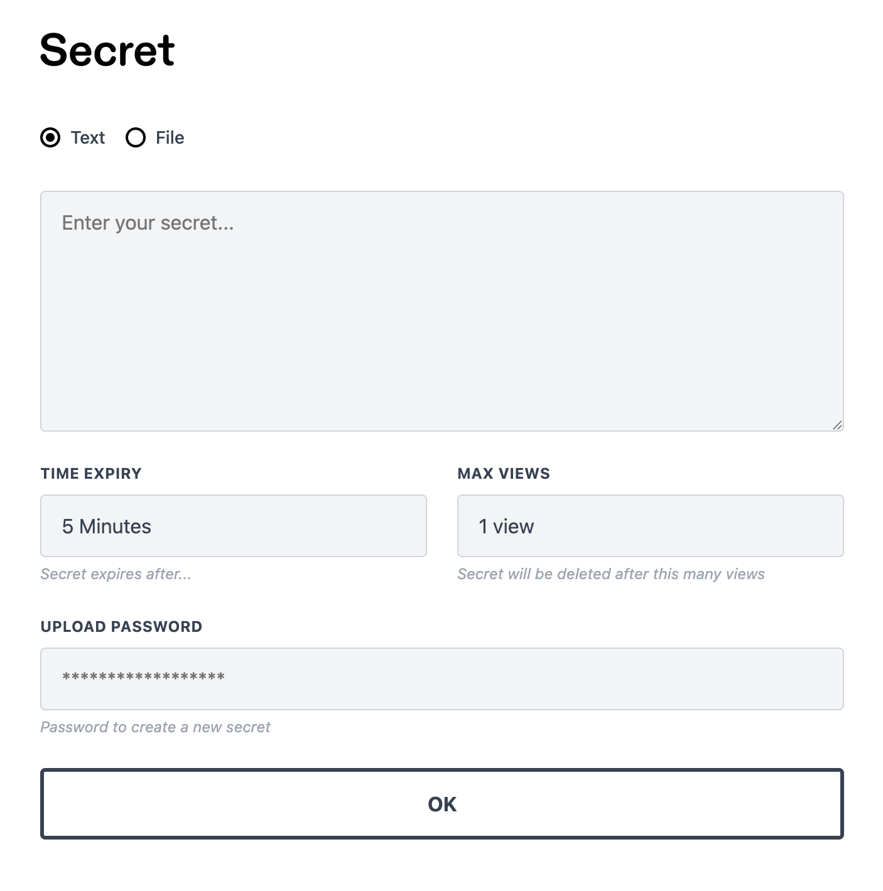

# Secret

Una aplicación PHP minimalista para compartir texto y archivos sensibles (como [onetimesecret](https://onetimesecret.com)), con cifrado completo de extremo a extremo AES-256-GCM. El servidor nunca ve los datos en texto claro, ya que se cifran con una clave del lado del cliente. Sin dependencias de frameworks y extremadamente simple de desplegar.



## Para qué sirve

Envía credenciales o información sensible a clientes y colegas sin que quede guardada para siempre en hilos de correo electrónico o chat propensos a filtraciones.

Los secretos se cifran del lado del cliente, se visualizan una vez y luego se eliminan. Para mayor seguridad, envía la URL y la CLAVE por separado a través de diferentes canales.

## Características

- Cifrado de extremo a extremo AES-256-GCM (Web Crypto API)
- Compartir texto y archivos (hasta 10 MB)
- Caducidad configurable (de 5 minutos a 7 días, o ilimitada)
- Límite de visualizaciones configurable (1, 3, 5, 10 o ilimitadas)
- Solicitar un secreto: genera un enlace de un solo uso para que alguien te envíe un secreto
- Sin framework, sin Composer, sin directorio vendor
- Base de datos SQLite (creada automáticamente)
- Despliegue subiendo los archivos a cualquier hosting con PHP

## Requisitos

- PHP 8.0+ con la extensión PDO SQLite
- `mod_rewrite` (Apache) o reescritura de URL equivalente
- [HTTPS con un certificado válido](https://developer.mozilla.org/en-US/docs/Web/API/SubtleCrypto) (requerido para la Web Crypto API)

## Instalación

1. Clona o sube el repositorio
2. Copia `.env.example` a `.env`
3. Configura `NEW_ITEM_PASSWORD` (recomendado: ver [¿Por qué configurar una contraseña?](#why-set-a-password))
4. Eso es todo. La base de datos SQLite se crea automáticamente en la primera solicitud.

## Despliegue

Sube todo el proyecto a tu servidor. Un `.htaccess` en la raíz redirige automáticamente todas las solicitudes a `public/` — no se necesita configuración de host virtual. Funciona en cualquier hosting compartido con Apache y `mod_rewrite`.

Si puedes configurar directamente el directorio raíz del documento de tu servidor web, apúntalo a `public/` para una configuración más limpia.

Sin `composer install`. Sin `npm install`. Sin paso de compilación. Sin dependencias en absoluto.

## Personalización

- **Logotipo/encabezado**: Reemplaza `public/images/header.png` con tu propia imagen.
- **Colores, fuentes, espaciado**: Edita las propiedades CSS personalizadas en la parte superior de `public/css/app.css`.
- **Lógica del lado del cliente**: Edita `public/js/app.js` directamente.

No se requiere un paso de compilación.

## Rutas

| Método | URL | Propósito |
|--------|-----|-----------|
| `GET` | `/` | Formulario para crear un secreto |
| `POST` | `/api/secret` | Crear un nuevo secreto (JSON) |
| `GET` | `/s/{id}` | Página para ver/descifrar un secreto |
| `GET` | `/api/secret/{id}` | Obtener datos cifrados (JSON) |
| `DELETE` | `/api/secret/{id}` | Eliminar un secreto |
| `POST` | `/api/request` | Crear una solicitud de secreto (requiere contraseña) |
| `GET` | `/r/{token}` | Formulario de solicitud (para el destinatario) |
| `POST` | `/api/request/{token}/submit` | Enviar un secreto mediante el token de solicitud |

## ¿Por qué configurar una contraseña?

- Sin una contraseña, cualquiera puede crear secretos
- No hay limitador de velocidad, por lo que un troll podría saturar el endpoint
- No hay protección CSRF (irrelevante sin una contraseña, ya que cualquiera puede crear secretos de todos modos)
- La sanitización se realiza del lado del cliente antes de la visualización (configurada mediante la variable de entorno `ALLOWED_TAGS`), ya que el servidor solo ve datos cifrados

## Pruebas

```bash
php tests/run.php
```

Ejecuta 111 pruebas que cubren la API, el conteo de visualizaciones, la caducidad, la carga de archivos, las solicitudes de secretos, los activos estáticos, la protección con contraseña, la validación de entradas y el manejo de errores. Utiliza una base de datos temporal: es seguro ejecutarlo contra una instalación en producción.

## Licencia

[GNU General Public License version 2](https://opensource.org/licenses/GPL-2.0)
